# MotoGP R2 — reference-driven graphics and riding improvements

This revision improves the existing playable motorcycle section: bike and rider geometry, track surfaces, machine selection, chase framing, race instruments and assisted braking. It builds on `f91463cf506f6feced1a4db9c43af48ac3632410` and retains the project's authored GP bodywork and original game content.

## All 100 references, individually accounted for

[The readable 100-image index](MOTOGP_R2_REFERENCE_INDEX.md) and [complete R2 reference ledger](motogp-reference-r2.json) contain one record for each numbered image, REF 001–100. All 100 source payloads were individually reviewed and their SHA-256 hashes verified. Each record identifies its source category, observations, applicable visual cues, implementation actions, affected files and limits. Applied changes link to shared validation checks; those checks verify the implementation rather than certify a recreation of the reference scene.

| R2 status | Images | Meaning |
| --- | ---: | --- |
| Partially applied | 74 | Named cues from the image informed specific changes in this revision. The complete depicted scene is not claimed as recreated. |
| Existing support reviewed | 10 | The primary depicted feature already existed and was reviewed. Shared R2 changes mentioned in these rows are cross-references, not a newly implemented primary feature. |
| Context only | 16 | The primary scene, discipline or mode remains context. Related shared changes are cross-references to applied rows, not a newly implemented scene or mode. |
| **Individually reviewed** | **100** | **All numbered images have their own observations and accounting.** |

The supplied pack mixes official store images, UI captures, promotional material and trailer frames. The source filename does not establish that every image is a verified PS5 gameplay capture. Press rooms, career narratives, indoor training and split-screen scenes in the pack are not newly implemented by this revision.

## What changed and why

### Bike and rider

The previous rider's straight capsule limbs and exposed rounded joints made close views look mechanical. The revised rider uses shaped upper arms, forearms, thighs and calves, leather-covered elbow and knee forms, thin protective sliders and torso panels that follow the suit. Collar, zipper, accordion inserts, glove knuckle caps, boot pivots and original helmet artwork add visible material and construction detail. Existing rider articulation and contact anchors remain the basis of the moving pose.

The motorcycle has sculpted fork clamps with actual bores and relieved shapes, nested caps and fasteners, switch housings and buttons, fluid reservoirs, lever pivots, hoses, curved wheel spokes and rounded brake calipers. Fairing clearcoat highlights were moderated to keep the painted bodywork readable. The hidden helmet retains a correctly placed shadow proxy in the onboard view.

These changes extend the existing Blender-authored body shell. No new Blender bake is claimed for R2: the editable authoring assets and previous body mesh remain available, while the new mechanical and rider details are generated by the game's geometry code.

### Matched visual comparison

The images below use the same production bike fixture, camera, pose, lighting and installed dependencies. The baseline imports repository modules from an archive of `f91463c`; the final image imports the R2 source. [The source manifest](motogp-r2/comparison-source-manifest.json) records the imported baseline and final hashes.

| Baseline | R2 |
| --- | --- |
| 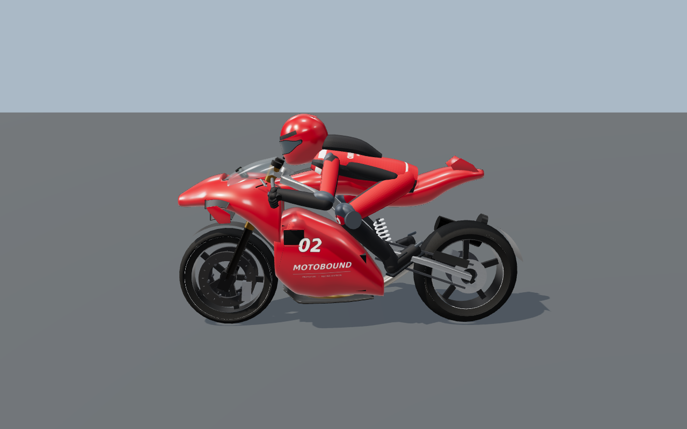 | 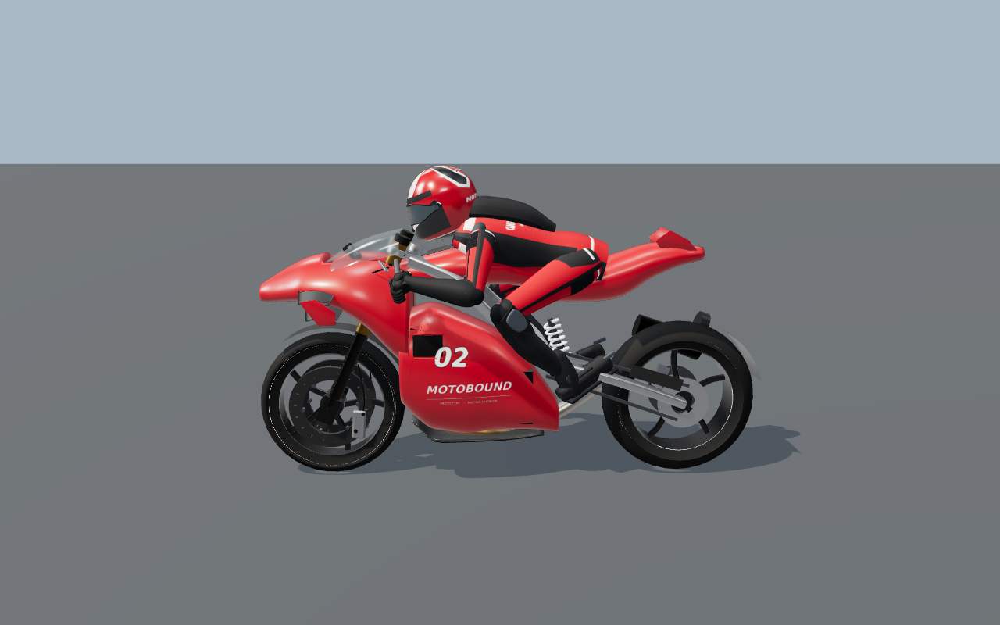 |

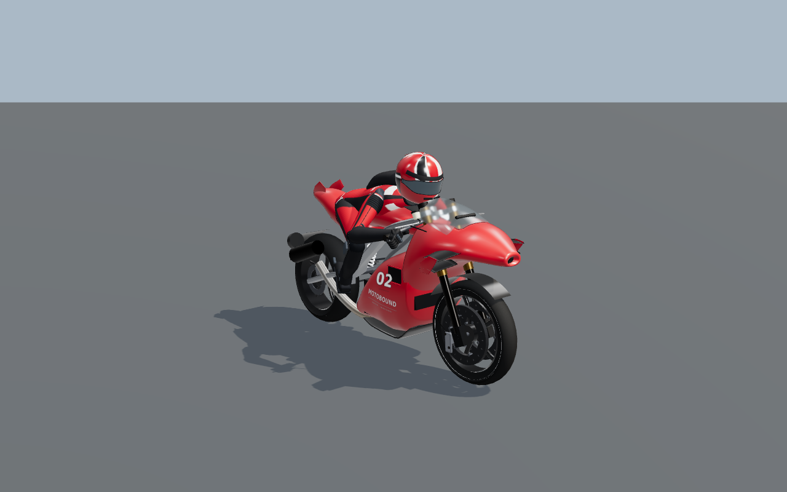

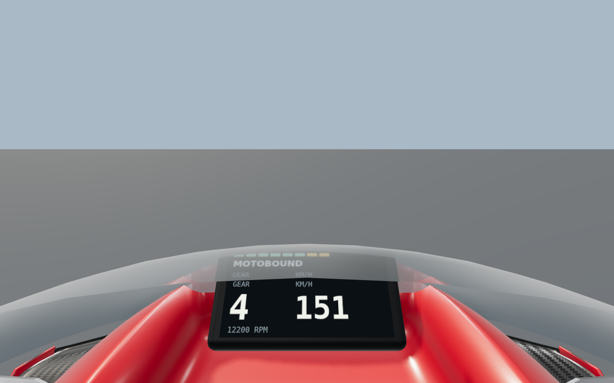

### Circuit surfaces

Motorcycle presentation now selects narrow single-contact rubber paths instead of the paired paths used for cars. The braking marks use the GP capability envelope; deposited rubber is narrower and less uniform. Launch marks use a single rear-wheel pattern. Grid paint and launch marks read the venue's grid definition, which keeps them aligned when venue definitions change; current GP grid coordinates already matched the old constants.

Kerb construction joints and chips now survive the later material-color setup. Curved scuffs continue across the kerb and runoff, with irregular grass and soil transitions. Vehicle-family changes reuse two bounded geometry layers and the original registered material, keeping weather and atmosphere hooks attached.

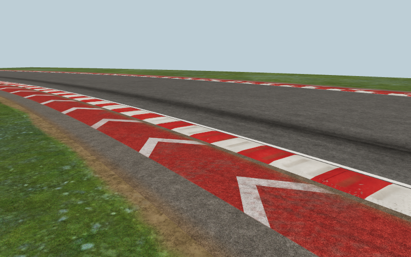

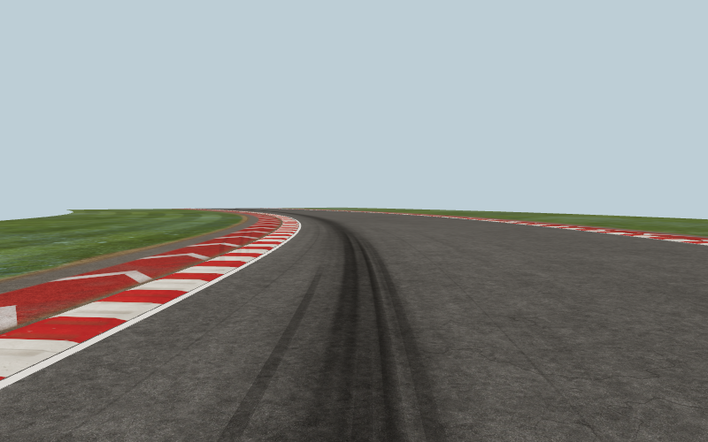

### Selection, cameras and instruments

Selecting GP-R1, GP-R2, SBK1000 or SS600 now presents the selected motorcycle in the menu, with motorcycle dimensions, static suspension sag and an appropriately framed showroom view. Returning from a session rebuilds that preview against the current venue. The preview uses its own frame and does not alter a running session's telemetry.

Motorcycles receive a closer, lower chase camera with bounded speed response and lean-based turn anticipation. Reduced-motion settings suppress the added motion. The existing onboard mount and clearance contracts are retained. The physical dashboard now uses the published gear number directly; a real GP-R1 session regression checks all six gears and prevents the previous off-by-one label. Renderer preparation now poses the correct vehicle family and selects its circuit presentation before shader compilation.

The motorcycle HUD places speed, gear, revs and riding information near the edge of the view. Motorcycle instruments refresh on every presented frame and share the physical dashboard's presented snapshot, avoiding the old one-in-three-frame delay on slow rendering. Car panel cadence remains unchanged. It reads the real front and rear tyre channels, selected-machine RPM limits, lean, rider state, tuck and combined traction/wheelie-control intervention. Rear-pedal and front-lever values are explicitly input percentages; assisted brake force is not mislabelled as pedal input. The bike MFD reports fork and shock travel, rider position, tyre condition and cosmetic fairing condition. Load split becomes unavailable when the rider is down rather than displaying stale riding loads. Switching back to a car restores the car instruments and four tyre labels.

The following images use production interface components with controlled test telemetry. They verify layout and labels, not a rendered race or driving performance.

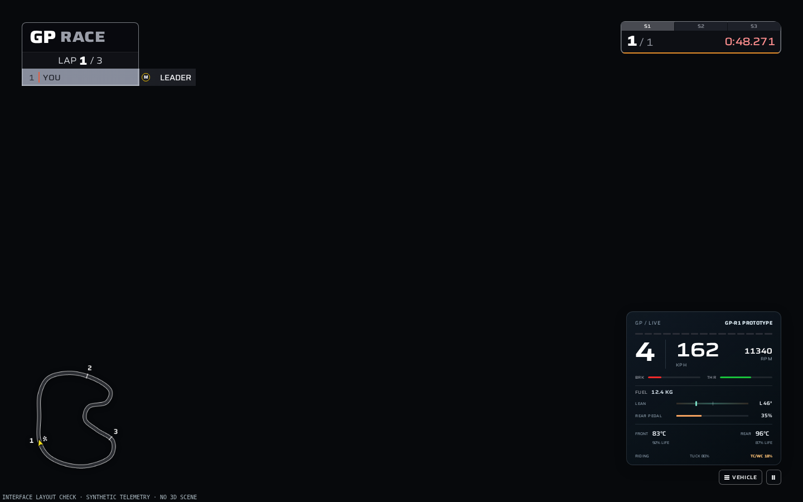

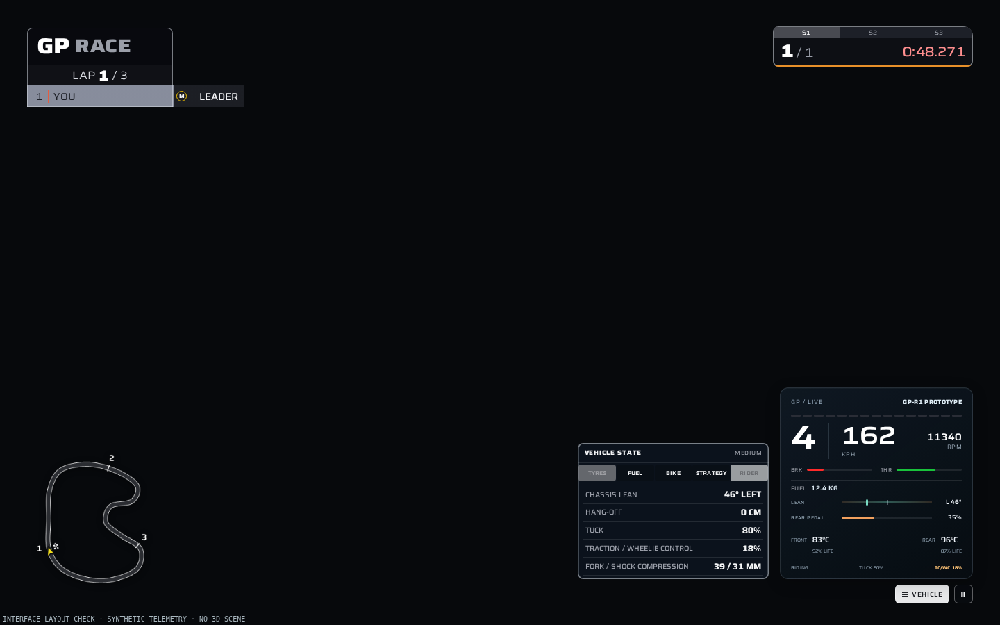

### Braking and tyre behavior

Combined braking previously assigned rear braking from an earlier load estimate without reserving sufficient grip for cornering. The solver now uses the current braking load transfer, constrains the rear braking/cornering force combination and checks the front force against the resulting pair. Rear utilisation includes braking demand. Unassisted lock, slide and highside behavior is retained.

Tyre work no longer consumes stale riding utilisation while the motorcycle is fallen. Its thermal work input is bounded while the diagnostic channel retains the actual demand.

[The braking report](motogp-braking-validation.json) separates prototype-default tests from production GP-R1 parameters. In the production GP-R1 dynamics-core cases, full assisted braking at a settled lean command of 0.7 produced these peak rear force-circle ratios:

| Grip multiplier | Before | R2 |
| --- | ---: | ---: |
| 1.00 | 1.003709 | 0.948897 |
| 0.65 | 1.141241 | 0.949127 |
| 0.40 | 1.466366 | 0.949315 |

The ratio compares combined tyre-force demand with the modeled available force. These controlled cases demonstrate the corrected constraint in this simulation. They do not establish real-world motorcycle calibration from photographs. The separate 12-case prototype test has a different parameter set and is explicitly labelled in the report.

All 19 seeded motorcycle race scenarios completed successfully, with all 158 riders finishing and six recoverable falls across the scenarios. [The complete results](bike-race.json) retain the individual outcomes.

## Validation and evidence

`npm run check:stable` completed with **exit 0**: lint, content validation, **355 test files / 3,009 tests**, TypeScript, the Vite production build and the existing source-stability guard all passed. No unhandled test errors remained. The test suite took **1,882.78 seconds**; Vite bundled the production build in **17.04 seconds**. The build fingerprint matches the complete-game captures below. [The repository validation record](motogp-r2/repository-validation.json) includes every test file, timings, source identity and the log hash.

An earlier complete run passed all 3,009 tests but exited on a worker reporting timeout. The two long racing-line tests now yield to the runner every 2,400 simulation ticks, using the pattern already present in endurance tests. Their simulation steps, loop limits, samples, assertions and timeouts are unchanged. The focused rerun and the final full gate passed. This removes a concrete long-blocking risk without claiming that the previous error's sole cause was conclusively established.

Vite reports its large-chunk warning. The successful build and the component rendering budgets below do not establish full-game download performance or a consumer-GPU frame rate.

### Complete game in the browser

The final production build completed machine selection, circuit entry, moving GP-R1 practice with three opponents, the chase-to-onboard camera switch and an acknowledged simulation pause. The run finished with no browser errors. Its source fingerprint is `24ab86c6938bdae4c47864709d37752293fb1a37ee52eb6cebba91a9d1ac78b0`.

This run used verified WebGL2 ANGLE SwiftShader at a 1440×900 viewport and the existing Low preset (1080×675 internal rendering). It is a software-GPU functional check, not a consumer-GPU performance measurement or full-scene High/Ultra acceptance. A concurrent CPU-suite attempt stalled during startup; the successful final browser run was performed separately. Original game deadlines and quality presets were retained.

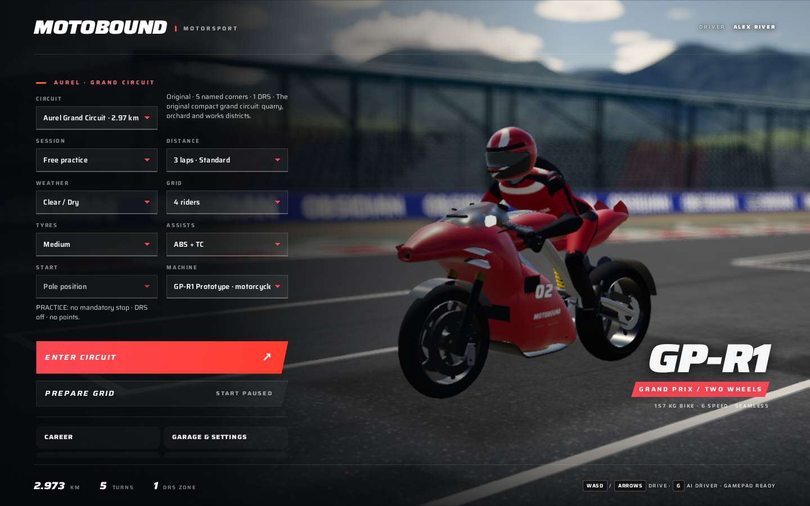

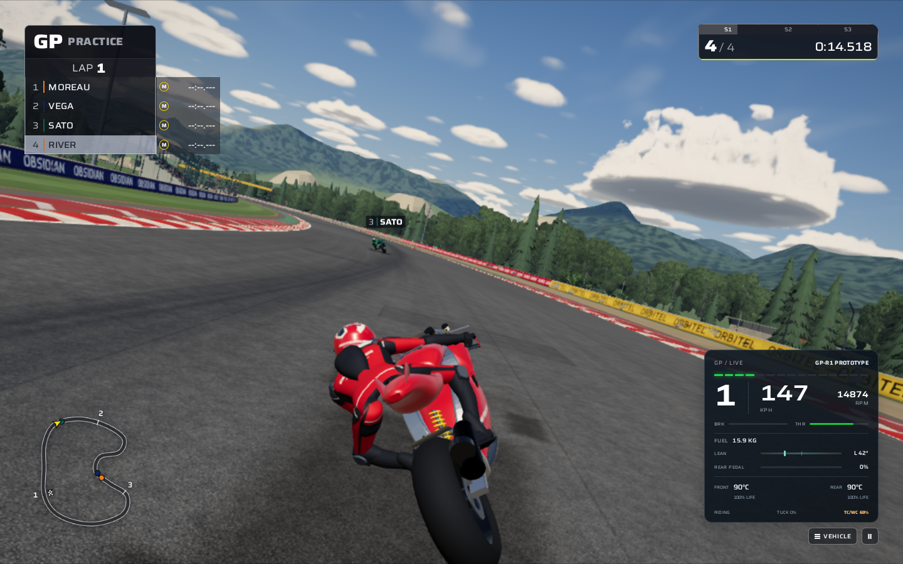

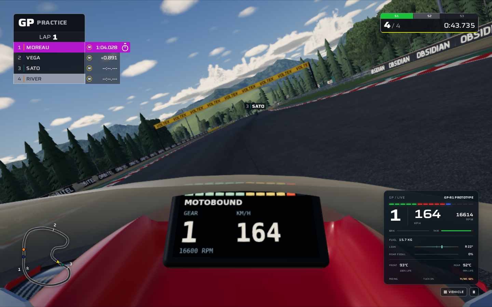

The [held onboard image](motogp-r2/full-game-held-onboard.png) shows **136 km/h and first gear** on both the physical dashboard and HUD, matching the published paused frame (136.404492 km/h, gear 1). The capture waited for the worker's pause acknowledgement and completed GPU work. Only the pause dialog and its backdrop were hidden for that evidence view. [The complete-game validation record](motogp-r2/full-game-validation.json) includes graphics settings, checkpoints, preparation results, image hashes and this capture-only presentation detail.

### Production bike on WebGL2

The unchanged `e2e/41-motogp-reference.spec.ts` completed all 14 captures on verified ANGLE SwiftShader. It exercises three detail levels, multiple motorcycle models, real onboard cameras and same-instance weather changes. Its original assertions and limits were not relaxed.

| Bike detail | Triangles | Draw calls | WebGL error |
| --- | ---: | ---: | ---: |
| High | 93,700 | 186 | 0 |
| Mid | 44,737 | 164 | 0 |
| Far | 12,538 | 85 | 0 |

The high-detail baseline was 75,298 triangles and 170 calls. Added geometry has a rendering cost; the final model remains within the existing fixture's 110,000-triangle and 220-call caps. These are component measurements, not full-scene frame-rate claims.

The dry → wet → held-wet → dry sequence produced hashes `1042509547 → 43448736 → 43448736 → 1042509547`, with unchanged resource counts and unmodified source frames. The final bike also passed the existing onboard visibility/clearance checks for GP-R1, GP-R2, SBK1000 and SS600. [The validation summary](motogp-r2/validation-summary.json) contains the measurements and final source hashes.

### Production surfaces and interface

`e2e/42-motogp-environment.spec.ts` completed ten captures using actual circuit ribbon shaders and four scanned ground material sets. Car/bike switching, held frames, wet response and dry restoration produced the expected pixel changes without accumulating resources at a fixed view. Thirty vehicle-family toggles retained the bounded cache. All captures had zero WebGL errors. [Surface measurements](motogp-r2/environment-material-metrics.json) are included.

The surface fixture uses production materials in a bounded scene. Its wet pass verifies shader response and restoration; it is not a complete wet or night-race visual acceptance run. Trackside architecture, crowds, vegetation and complete wet/night lighting were not rebuilt or given full visual acceptance in this revision.

`e2e/motorcycle-presentation.spec.ts` passed the production DOM/CSS layout checks at 1440×900, 960×600 and 390×844, at both 1.0 and 1.35 UI scale. It checks instrument visibility, no cluster overflow, non-overlapping desktop MFD, fallen-state clearing, front/rear tyre data, menu machine switching and restoration of the car interface. Four successive single-call snapshots verify immediate motorcycle speed, gear, RPM and lean updates, while cars retain their one-in-three cadence. [The final UI verification record](motogp-r2/ui-validation.json) includes the source hashes and regression result.

## Reproduce

Use the locked dependencies and the project's supported Node version:

```sh
npm ci
npm run check
npm run test:bikes
npx playwright install chromium
npx playwright test e2e/41-motogp-reference.spec.ts e2e/42-motogp-environment.spec.ts e2e/motorcycle-presentation.spec.ts
```

The repository's browser configuration verifies the selected graphics backend and uses one GPU worker. The controlled model, surface and DOM tests are separate from the full-race browser suite. Keep the original deadlines, assertions and presets when comparing results.

For manual inspection, run `npm run dev`, select a motorcycle and enter the circuit. `C` switches camera and `G` toggles the existing demonstration driver. Inspect the machine-selection preview, riding view, front/rear tyre instruments and the rider MFD. The existing settings expose rendering quality and reduced-motion preferences.

## Scope of this delivery

R2 delivers substantial changes to the existing motorcycle presentation and specific riding defects. Its rider remains a procedural articulated model, and the authored bike shell remains the prior asset. The evidence does not certify commercial MotoGP/PS5 visual parity, perfection, consumer-GPU performance, every image's complete scene, or the complete release/browser matrix. The reference ledger keeps those distinctions explicit so that future work can be evaluated against concrete remaining requirements.
