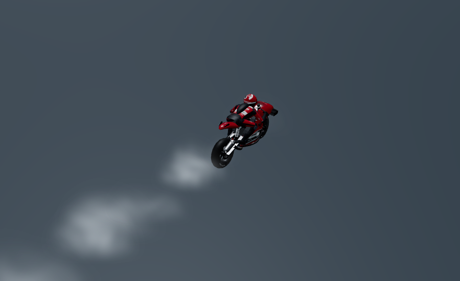
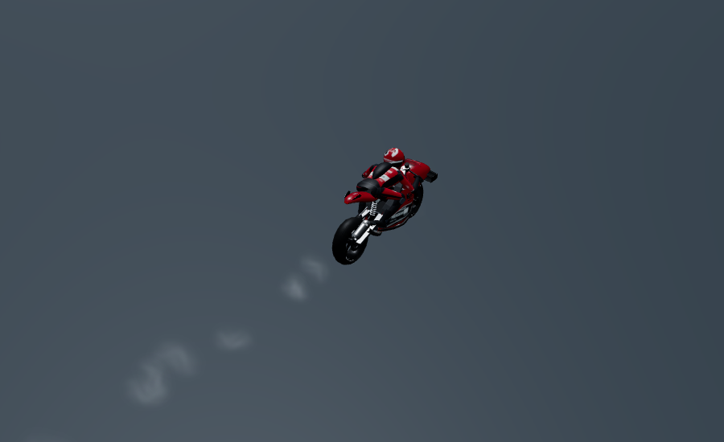
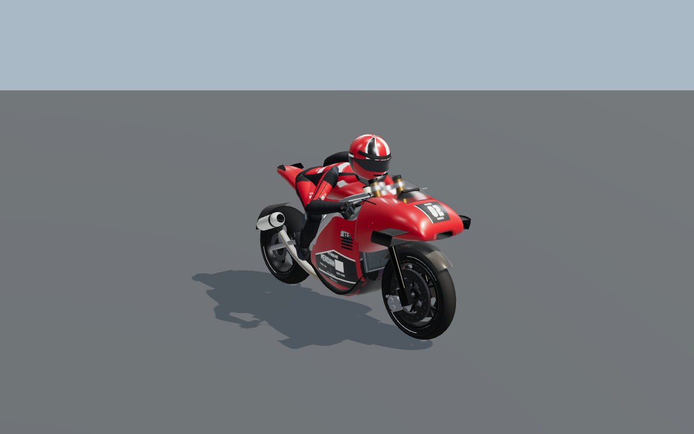
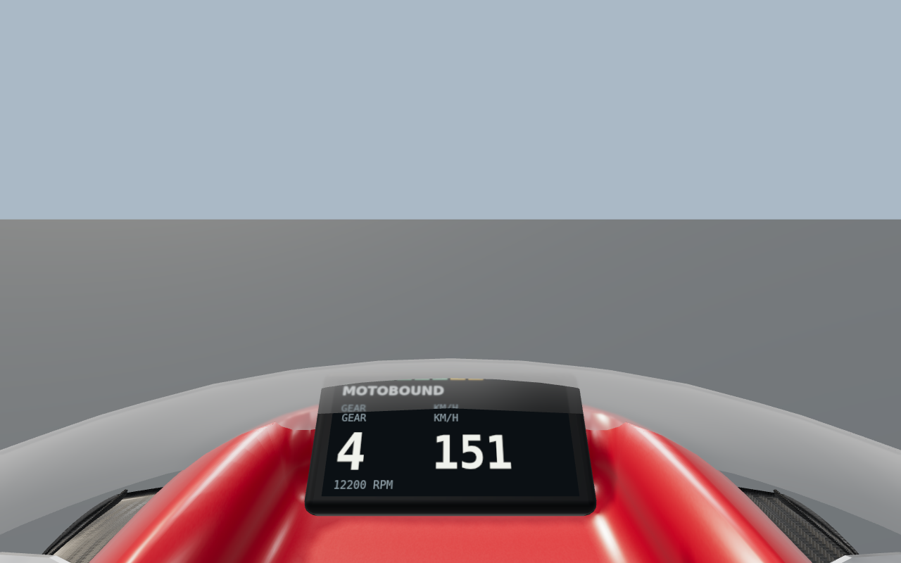
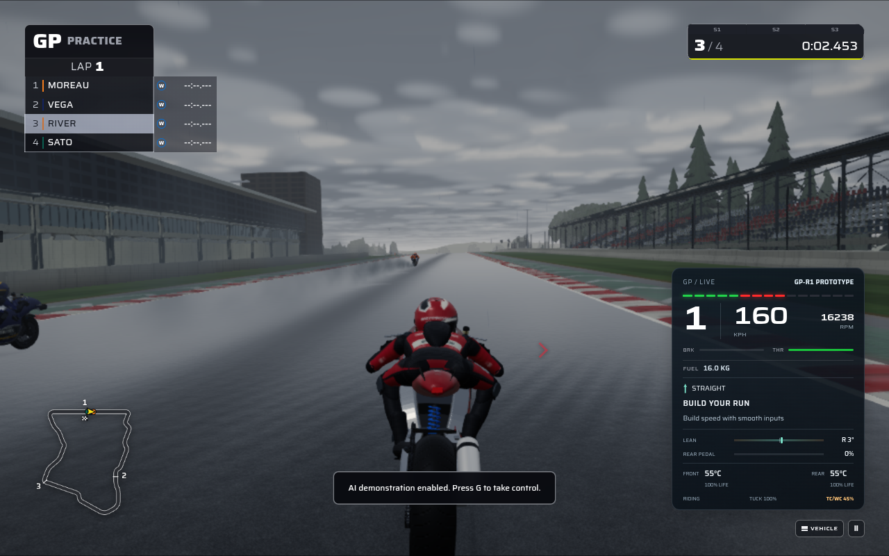
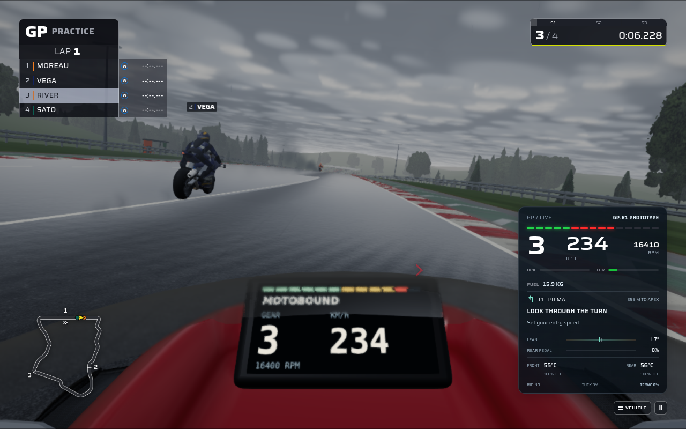

# MotoGP contact, control and mechanical-detail update

This pass builds on `88e604b` and the existing [100-image review](MOTOGP_THREEJS_REFERENCE_REVIEW.md). It improves the two GP prototypes' tyre behavior, high-speed AI braking, wet contact effects, mechanical detail and riding feedback using the existing TypeScript simulation and Three.js renderer.

The previous update already supplied forged wheels, tyre wear, GP grounding, slipstream/corner advice and narrower passing corridors. Those are the baseline for this work. The new behavior described here is additional.

## Reference evidence

All 100 numbered payloads were checked against the supplied manifest. The archive SHA-256 remains `478517180397aa7022b508264e2e6383f721ea930a4035ef314e2e8fb421e7c6`. All five category contact sheets were reopened; the relevant mechanical and wet-contact originals were inspected in detail by the rendering reviewers.

The [reference audit](production/motogp-contact-pass/reference-audit.json) records every image's ID, hash, source page and relationship to this pass. The earlier one-by-one ledger remains available. Images from other riding disciplines retain their contextual role.

| Reference cues | Application in this pass |
| --- | --- |
| REF 001, 022: compact front construction and recessed mechanical surfaces | Curved radiator core, formed tanks, filtered fins and protective mesh within the existing fairing envelope. |
| REF 010, 017, 034–038, 096: wet tyres, narrow bike footprint, readable rider and road | Two actual tyre emitters, correctly located through lean, with lifted/fallen contacts suppressed. |
| REF 018, 032, 039, 060, 067, 071, 087, 098: independent tyre contacts and loaded shoulders | Contact projection is shared by effects and grounding; the simulation preserves front/rear surface grip independently. |
| REF 015, 017, 027, 035, 045: visible road boundaries and readable riding views | Axle-specific recovery, brake heat and intervention advice in the existing GP instrument cluster. |

The images establish visible proportions, materials, posture and information hierarchy. They do not establish numerical friction coefficients, braking gains, particle rates or the source game's physics. These remain original simulation and presentation decisions.

## What changes when riding

### Independent front and rear grip

Previously, the GP adapter took the lower of the front and rear grip samples and applied that value to both tyres. A front tyre touching a weak surface therefore removed useful rear-wheel drive even when the rear tyre remained on clean asphalt. The reverse problem affected front braking.

GP-R1 and GP-R2 now retain each contact's actual surface, water, temperature, wear and damping response for its force budget. Traction control, cornering ABS, load transfer and crash utilization use the appropriate tyre. The conservative lower grip still limits lean intent and AI approach planning.

For example, in the repeatable 35 m/s GP-R1 test with front contact grip 0.35 and rear contact grip 1, available rear drive changes from approximately **660 N to 1,875 N**. When the rear contact is the weak one, rear drive remains approximately **656 N**. This is a correction to which tyre supplies the force; it adds no global power or grip multiplier. Equal-grip core trajectories remain exactly identical, and other motorcycle families retain their shared-grip behavior.

### Braking plans account for GP speed

The shared AI looked 240 metres ahead. With the corrected contact forces, a GP bike could reach a long-straight hairpin before that window allowed enough braking. An initial clear Poggio Alto race exposed a real runoff and fall, which was traced and corrected.

The GP rider now extends the existing brake-envelope calculation over its conservative stopping distance, plus its lean-preview distance. It reuses two fixed 128-sample buffers at the existing 12-metre spacing, capped at **1,524 metres** and one circuit. It can only lower the speed target already established by traffic, flags and pit logic. Pit, off-track, reverse recovery and other motorcycle controllers keep their existing behavior.

Both GP prototypes now pass the controlled **324 km/h** approach test in clear weather and rain on wet tyres. The independent tyre budgets and physical crash thresholds remain active. Three two-lap, eight-rider production races also classify all riders without impacts, crashes or penalties: Aurel/clear, Poggio Alto/clear and Poggio Alto/rain.

The [physics receipt](production/motogp-contact-pass/riding-physics-checks.json) contains the exact scenarios, force comparisons, approach speeds, test outcomes and resolved investigations. The full wet race requires more than 400 simulated seconds even on the baseline; its new regression allows 700 seconds while retaining the strict completion and incident assertions.

### Advice explains the condition that matters

The existing GP corner guide now adds short, snapshot-driven control advice:

| Condition | Example feedback |
| --- | --- |
| Front tyre on a wet kerb while loaded/braking | **FRONT ON WET KERB** — Ease braking · keep inputs smooth |
| Rear tyre on wet paint during corner exit | **REAR ON WET PAINT** — Pick up bike · add power gently |
| Front or rear tyre on grass/gravel | Identifies the affected tyre and gives recovery advice. |
| Front lift or a lightly loaded rear under braking | Explains how to settle the bike using the relevant input. |
| Actual brake fade while using the hot brake | **FRONT BRAKE HOT** or **REAR BRAKE HOT** with appropriate advice. |
| Strong combined traction/wheelie intervention in a leaned exit | **POWER LIMITED** — TC/WC active · roll on smoothly |
| Puncture | Identifies the tyre and directs a slower return to the pits. |

Marshal instructions retain priority. Feedback reads the actual front/rear channels, ignores duplicate car-compatibility channels and restores immediately when the presented replay snapshot changes. Recovery advice remains visible beyond the track edge under a neutral **BIKE CONTROL** heading; corner directions and tow advice still require valid forward progress along the circuit. The guide does not treat handlebar steering or the rear demand proxy as measured tyre slip.

The guide's action and advice text are larger, with tighter spacing to retain the existing desktop, compact landscape and phone layout limits at normal and 1.35 UI scales.

## Three.js rendering changes

### Two physical contact effects

The circuit particle system previously used Formula-car wheel positions and a diffuser plume for GP motorcycles. The GP adapter now uses front channel 0 and rear channel 2, suppresses duplicated channels 1 and 3, and removes the car diffuser plume.

Effects and indirect grounding share the same contact projection from the recorded bike pose, rounded tyre crown, shoulder, pitch and lean. For an upright GP-R1, the front/rear longitudinal origins are **+0.70 / −0.75 m**, with births 35 mm above the recovered road. Wheelies emit from the loaded rear; falls and pit stands create no new ground-contact emissions. Existing particles continue their normal bounded lifetimes.

Pose-value caching handles reused snapshot buffers, same-time pose changes, held frames and replay seeks. The adapter adds no textures, scene draws or particle capacity. Controlled compatibility tests retain identical particle attributes and birth counts for APX-01, TC1, SBK1000 and MX450. Front steering is no longer mistaken for a GP tyre smoke signal.

The controlled WebGL comparison records 56 legacy spray births versus 28 corrected births, zero GP diffuser births, rear-only wheelie births and zero fallen-state births. Held-frame and cleared-seek pixels are identical. The original **3,600 contact / 600 rain** pool capacities remain unchanged.

The first live wet capture also exposed oversized, opaque spray inherited from the car renderer. GP spray now uses **0.35 times the billboard radius and 0.32 times the final optical opacity**. A fixed, 3,600-byte birth-profile array keeps each particle's original vehicle family, including when the ring buffer is recycled or the camera changes. Particle counts, raw size/opacity/lifetime values, random draws and motion remain unchanged. The profile adds one fixed GPU attribute without a new production draw call, material or texture.

In the controlled moving comparison, both emitters travel 15 metres over 0.5 seconds at 30 m/s and produce 28 births with identical raw particle data. Pixels affected by spray drop from **68,410 to 13,328**, while aggregate RGB deviation from the no-spray image drops from **4,335,330 to 312,084**. These are image-space measurements, not physical optical-depth estimates. The retained view shows smaller, faint, individually separated wisps and a more readable rider/rear tyre. Both non-GP comparisons produce zero changed pixels, including comparison against the original shader compiled without the profile branch.

The final warmed comparison fixture holds **95 geometries, 19 textures and 45 programs**; both moving views submit 173 total draw calls. These counts include its additional comparison instance and original-shader control. They establish bounded fixture work, not whole-race frame rates.

| Same moving tyre history, profile off | Final GP spray profile |
| --- | --- |
|  |  |

### Recessed curved cooling pack

The former plain radiator box is replaced with a curved fin core, formed side tanks, rails, mounting tabs, dark rear casing and a protective mesh. It occupies the same **360 × 260 × 40 mm** envelope. The core's fine fins and mesh use continuous metric shader coordinates and derivative filtering, so distant patterns converge to their average coverage instead of shimmering.

The radiator uses one merged mesh and one entrant-owned material shared by high and mid LODs: **204 triangles on high, 132 on mid**, replacing the 12-triangle box. Far LOD adds no radiator geometry or material. The actual assembled bike tests verify sightlines through the fork/fairing, wet-material composition and disposal.

| High-detail model | Expanded triangles | Measured draw calls | Existing limits |
| --- | ---: | ---: | --- |
| GP-R1 | 109,337 | 215 | <110,000 triangles; <220 calls |
| GP-R2 | 101,636 | 205 | <110,000 triangles; <220 calls |

These full production-model fixtures report zero GL errors. The radiator improvement is most visible in front and three-quarter detail views.

### Readable instruments through the curved windscreen

Live cockpit review exposed duplicated instrument labels and a displaced rev-light strip. The curved windscreen is an open sheet, but its previous 2 mm transmission-volume setting displaced the nearby dashboard as if light travelled through a closed volume. The GP glass now uses Three.js thin-wall transmission (`thickness: 0`), preserving its shape, IOR, transmission, opacity and reflection band.

Both prototypes pass a same-instance optical sequence: previous volume setting, production thin wall, held production frame and restored previous setting. Framing, geometry, material properties other than thickness, resources and submitted work stay identical. The held frame matches exactly, and restoring the old thickness restores its exact pixel hash. The retained GP-R1 images confirm one aligned GEAR/KM/H label row and the correctly aligned rev-light strip. The [optical receipt](production/motogp-contact-pass/optics-metrics.json) covers both prototypes.

| Previous volume refraction | Production thin-wall transmission |
| --- | --- |
|  |  |

## Actual application checks

Both final menu-to-riding journeys pass on the combined source after preserving the independent motocross update at `ecc8099`. Every retained application checkpoint reports the production fingerprint `623f4a67851c64eb699dd1b9706eb0e60a8335605e4abb6e5862212d92393a4e`, which matches an independent recomputation using Vite's exact 715-input ordering.

The clear session covers normal menu entry, four GP-R1 riders at Poggio Alto, manual throttle followed by AI demonstration, named corner guidance, chase/cockpit switching, pause, recorded replay, seeking away and back, and return to live riding. The rain session enters with wet tyres and verifies loaded wet contacts, active spray, four advancing riders, both cameras, worker pause acknowledgement, presentation drain, held effects and resumed simulation.

In the wet pause check, the simulation tick, presented time and entire particle diagnostic object remain identical across **six additional rendered frames**. The test then resumes and requires more than 60 further simulation ticks. Both journeys report zero page/console errors.

The following images are from the actual application at **1280 × 800, Low preset**. Rain uses particle density 1, selected through the normal settings UI. High-detail model and material fixtures remain separate from these functional sessions. The [live application receipt](production/motogp-contact-pass/live-application-checks.json) retains the exact scenarios, checkpoint summaries, layout bounds and image hashes.

| Final wet chase view | Final wet cockpit view |
| --- | --- |
|  |  |

Additional captures: [clear chase](production/motogp-contact-pass/gp-live-clear-chase.png), [clear cockpit](production/motogp-contact-pass/gp-live-clear-cockpit.png), [recorded replay](production/motogp-contact-pass/gp-recorded-replay.png). The [earlier wet capture](production/motogp-contact-pass/gp-live-wet-before.png) precedes the final spray/optical refinement and uses a different real-time frame history; it is not a controlled pixel comparison. The [control-advice image](production/motogp-contact-pass/gp-control-feedback.png) is an explicitly labelled synthetic telemetry fixture.

## Validation and review limits

| Check | Result and scope |
| --- | --- |
| `npm run check` | Passed: lint, content validation, **428 test files / 3,567 tests**, TypeScript and production build. This broad run preceded the final spray/optical refinements and the independent motocross fast-forward. |
| Final focused integration run | **16 files / 137 tests passed** on the combined tree, covering the final GP rendering/feedback, shared effects and relevant updated motocross integration. |
| Final lint, content and build | All passed after the fast-forward; independently recomputed source and build fingerprints match. |
| Final model/optics, spray and HUD browser fixtures | **Three passed** on the final GP source. The HUD includes six advice conditions at three viewports and two UI scales. |
| Surface and grounding browser fixtures | Passed; retained receipts cover wet rewind, held frames and bounded presentation resources. These paths were unchanged by the final optical/profile refinement. |
| Actual clear and wet application journeys | **Two passed** on the combined production build, in 178.732 and 159.918 seconds respectively. Both used normal menu entry and real simulation snapshots. |

The [delivery receipt](production/motogp-contact-pass/delivery-checks.json) records commands, validation scope, resolved investigations, code hashes and evidence hashes. The final 137-case run is additional targeted coverage; the complete combined repository suite was not rerun after the non-overlapping motocross update. The existing large-bundle build warning remains.

The [model receipt](production/motogp-contact-pass/model-metrics.json), [surface receipt](production/motogp-contact-pass/surface-metrics.json), [grounding receipt](production/motogp-contact-pass/grounding-metrics.json) and [contact-effects receipt](production/motogp-contact-pass/metrics.json) retain the selected passing WebGL evidence and measured resource limits. The browser backend is Mesa llvmpipe through ANGLE, so the results establish compilation, deterministic presentation, bounded resources and functional behavior; they do not establish physical-device frame rates.

This remains an original procedural racing game with a reduced motorcycle solver. The work improves specific mechanical, contact and control inconsistencies; it does not establish visual parity with the commercial reference game. Fixed-position effect fixtures are explicit controlled scenes, and live application captures are identified separately.

The final live images retain the corrected narrow wet wake and a single aligned instrument label row. Their Low preset and software renderer are explicit review conditions, not a claim of maximum visual quality or certified frame rate.
