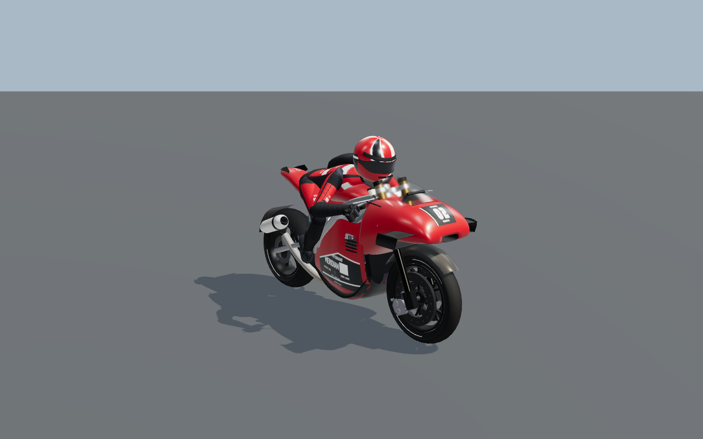
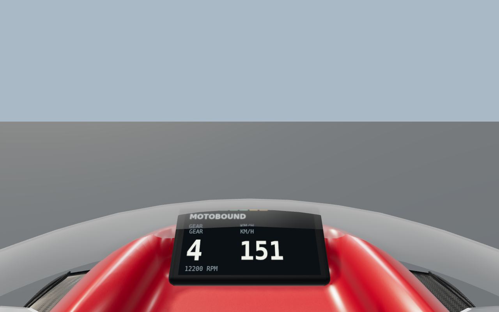
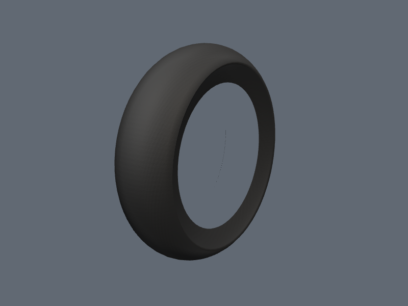
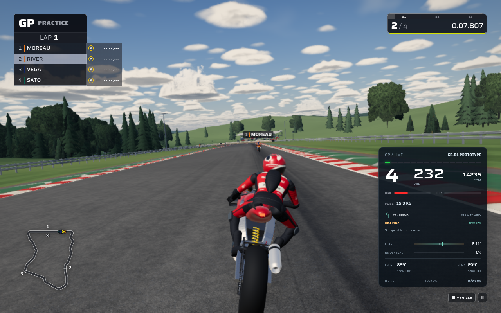
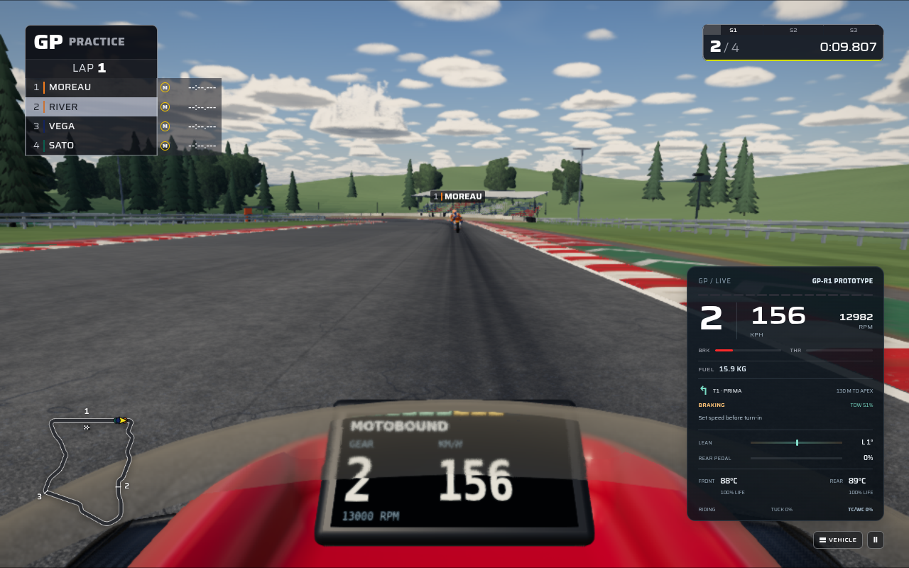

# MotoGP Three.js reference review — 18 October 2026

## Evidence and scope

The reviewer inspected every numbered image in the tracked [100-image reference pack](../reference/MotoGP26/MotoGP26_PS5_100_Reference_Images.zip). Fresh contact sheets displayed ten references each at approximately 790 × 445 pixels per image; REF 018, 060 and 096 were also inspected at their original 1920 × 1080 resolution for wheel construction and material detail. All 100 image hashes match the pack's `MANIFEST.csv`, and its IDs form the complete sequence 001–100.

Pack SHA-256: `478517180397aa7022b508264e2e6383f721ea930a4035ef314e2e8fb421e7c6`.

The pack contains 10 official PlayStation Store captures, 3 UI images, 34 gameplay/model/track images, 49 trailer frames and 4 detail crops. The pack manifest identifies the sources; some promotional/trailer sources do not identify their capture platform. Several frames depict minibikes, dirt riding, street bikes, career scenes or promotional text. Those images provide context and transferable visual principles. They do not establish a requirement to add those separate disciplines to this MotoGP change.

This document records observations and implementation directions. Image review does not certify a completed visual match. A still image establishes visible posture, material response, spacing and framing; it cannot establish the source game's numerical physics model.

## Priorities established by the images

1. **Wheel construction and rubber:** paired, slender forged spoke branches; a recessed rim channel; localized sidewall markings; a broad matte crown and softly worn shoulders. The contrast between dark rubber, satin wheel finish and brake hardware matters more than added decoration. REF 018 and 060 are the clearest construction views; 071 and 087 explain the rear silhouette.
2. **Raceable space around a leaned bike:** close opponents keep recognizable independent silhouettes. Bike lean and the rider's extended knee occupy more lateral space than an upright wheel track. Passing logic should respect that changing footprint and leave a usable escape corridor. REF 003, 021, 030, 048, 058, 079, 080, 090, 094 and 099 supply the visual cues.
3. **Readable corner approach:** the road ahead remains visible above the bike and cockpit. Show a concise next-corner/braking cue, and explain a usable slipstream when it exists. Stable horizon behavior should support steering; highly rolled trailer cameras belong to selected presentation shots. REF 013–017, 055, 074, 076, 077 and 088 are especially useful.
4. **Material scale and circuit construction:** the asphalt has fine aggregate, broader rubber paths and surface repairs; curbs have directional wear and individual grooves. Fences, grandstand structure, pit bays and shadows supply human scale. REF 004, 006, 030, 031, 033, 036–038, 044, 045, 047, 062, 077 and 082 distinguish the scales.
5. **Coherent materials under changing light:** fairing clearcoat, carbon, leather, alloy and rubber retain distinct responses. Wet tarmac shows broken broad reflections and localized pooling, with subdued cool lighting. REF 010, 017, 034–038, 050, 057, 065, 073, 095 and 096 are the material checks.
6. **Ground contact at motorcycle scale:** contact darkness stays tight beneath two tires, with a narrower soft body shadow that follows lean. REF 018, 032, 039, 060, 067, 071, 087 and 098 provide the scale check. Source inspection found the existing circuit grounding shader stamped a Formula floor, wings and four car-size tire contacts under every entrant. That existing mismatch became the targeted circuit-material improvement; no additional asphalt layer was needed.

## One-by-one coverage

`Direct` means the cue applies to the MotoGP riding scene. `Context` means the image depicts another discipline, a cinematic/career scene, or information that requires separate product scope. Directions describe how the image can inform the implementation and its review.

| Ref | Use | Observed cue | Implementation or review direction |
| --- | --- | --- | --- |
| 001 | Direct | Upright front pack; layered wings, recessed intakes, compact fork/brake hardware. | Preserve the front fairing silhouette and contrasting metal/rubber values; readable opponent separation. |
| 002 | Direct | Deep lean; rider head and torso move inside the bike; knee opens toward the road. | Account for the leaned rider footprint and inspect independent body positioning. |
| 003 | Direct | Two bikes run very close while retaining distinct bodywork, tires and riders. | Reserve lateral clearance using the occupied bike/rider envelope. |
| 004 | Direct | Rubber-darkened corner beside grooved red/white curb and broad painted runoff. | Inspect surface detail at three scales and keep the apex boundary legible. |
| 005 | Context | Dirt rider uses a more upright torso and extended inside leg. | Transfer articulated joint and material principles; the stance belongs to dirt riding. |
| 006 | Direct | GP field passes repeated pit bays; wheel, rider and building scale agree. | Keep believable wheel detail and pit architecture proportion. |
| 007 | Context | Indoor minibike corner has strong roof-shadow bands and tire barriers. | Reference structural shadows and believable material differences. |
| 008 | Direct | Leading and following bikes overlap in a telephoto composition. | Maintain depth and silhouette separation; use shallow focus only in suitable presentation views. |
| 009 | Context | Small-bike pack crosses warehouse shade with distinct rider poses. | Reference rider variation and light transitions; retain GP-specific posture in races. |
| 010 | Direct | Wet GP corner under a cool overcast sky; tarmac reflects broadly and unevenly. | Review damp rubber/fairing/tarmac response together; pooling remains localized. |
| 011 | Context | Rider identity screen uses a restrained form beside a detailed suit. | Reference information hierarchy and leather panel detail; character-creation scope is separate. |
| 012 | Context | Garage setup shows selected suspension values and an explanation beside the bike. | Any future setup controls should explain their actual handling effect. |
| 013 | Direct | Split-screen chase views retain a visible future corner and compact timing/gear information. | Preserve forward track visibility and a concise, readable racing HUD. |
| 014 | Direct | Starting grid has staggered bikes, grid paint and a prominent light gantry. | Validate start spacing, forward view and clear start-state communication. |
| 015 | Direct | Chase view shows curb contact, rider hang-off, a following pack and the next direction. | Keep apex/braking information clear and passing clearance sensitive to lean. |
| 016 | Direct | Three-quarter grid view exposes tire marks, starting boxes and pit-building rhythm. | Review track scale, start alignment and human-sized environment repetition. |
| 017 | Direct | Wet cockpit view keeps a long forward sightline; raindrops and instrument details remain secondary. | Avoid obscuring the next corner; surface/weather feedback should support control. |
| 018 | Direct | Full side view clearly shows branched forged spokes, recessed rim, flush sidewall paint and crouched rider. | Primary wheel-topology, rim-profile, sidewall-marking and rider-proportion reference. |
| 019 | Direct | A leaned leader is followed by a progressively distant pack. | Preserve readable race depth, shoulder clearance and consistent bike proportions. |
| 020 | Direct | Two riders lean with different offsets; slick tires remain matte in sunlight. | Validate per-bike poses and controlled tire roughness. |
| 021 | Direct | Near-parallel overtaking bikes leave a very small visible gap. | Model passing corridors from both riders' occupied widths. |
| 022 | Direct | Close front fairing has dark intake cavities, slim wing edges and continuous paint highlights. | Judge geometry by flowing highlights; keep intake surfaces recessed and dark. |
| 023 | Context | Indoor minibike leans across a patterned roof shadow on worn flooring. | Transfer shadow and wear scale; indoor riding is separate from GP circuits. |
| 024 | Context | Dirt bike exposes long suspension, spokes and an upright rider. | Useful mechanical contrast; retain GP-specific wheel and suspension dimensions. |
| 025 | Context | Smaller street bike crosses a visibly ribbed curb with modest body lean. | Transfer curb scale and progressive corner feedback. |
| 026 | Context | Dirt-start group has varied boot positions, exposed spokes and dust. | Reference state-driven rider pose; dirt-specific geometry is outside this pass. |
| 027 | Direct | Low view shows an inside elbow/knee close to the road and a loaded tire shoulder. | Review lean clearance and the low-speed/large-lean occupied envelope. |
| 028 | Context | Street bike has a smooth fairing, transparent screen and clearly separated fork/wheel materials. | Reference smooth specular flow and restrained windscreen material. |
| 029 | Context | Tight street-bike group shows riders looking into the next part of the corner. | Transfer directional attention and pack pressure without importing a separate bike class. |
| 030 | Direct | Overhead lean view shows multiple rubber arcs, independent shadows and a following line. | Passing and camera behavior should make the intended path and available space readable. |
| 031 | Direct | Corner asphalt and red/white curb are heavily scuffed along the travel direction. | Review directional wear and distinguish groove detail from broad rubber deposits. |
| 032 | Direct | Low bike angle is grounded by large pit structures and a broad asphalt foreground. | Keep bike-to-building scale and grounded wheel contact. |
| 033 | Direct | Distant grandstands contain varied crowd colors, fence lines and roof/structure depth. | Judge surroundings at gameplay distance; structural rhythm matters. |
| 034 | Direct | Wet straight passes beneath a dark bridge; the road retains visible aggregate. | Wetness should preserve road texture and coherent light transitions. |
| 035 | Direct | Wet race pair keeps tire/fairing contrast under flat light. | Check that overcast conditions retain useful material separation. |
| 036 | Direct | Water gathers near curb/runoff while the ridden lane is less reflective. | Review lateral pooling variation and curb-edge wet response. |
| 037 | Direct | Wet corner foreground is supported by exposed grandstand columns and seats behind. | Keep foreground grip cues and background structure plausible together. |
| 038 | Direct | High view of wet lean exposes the narrow cockpit/tank and patterned road sheen. | Review clearcoat, rubber and tarmac with the same weather state. |
| 039 | Direct | Dry corner shows dark loaded rubber, a close tire shadow and a distant crowd horizon. | Preserve a grounded contact silhouette and controllable highlight intensity. |
| 040 | Context | Dirt-course shot layers grass, track grooves, fences and distant buildings. | Transfer environmental depth and material scale to GP surroundings. |
| 041 | Context | Overhead dirt group crosses a broad worn curb with varied rider offsets. | Reference curb wear and articulated posture; dirt dynamics remain separate. |
| 042 | Context | Minibike city/warehouse scene uses foreground overlap and thin spoke detail. | Reference visual depth; GP wheels should retain their forged construction. |
| 043 | Context | Indoor rider crosses alternating roof-light and shadow bands. | Transfer structural light cues where a GP track has overhead structures. |
| 044 | Context | Street-bike corner has deeply grooved curb, scuffed cyan runoff and layered distant scenery. | Transfer curb construction, surface wear and distance scale. |
| 045 | Context | Street-bike tires cross a weathered curb beside fencing and a mountain backdrop. | Reference actual scale and worn surface boundaries. |
| 046 | Context | Street-bike front wheel exposes a machined brake ring and dark rubber crown. | Material contrast reference; use GP geometry dimensions. |
| 047 | Context | Low street-bike view emphasizes rough asphalt, curb scuffing and layered grass slopes. | Reference detail frequency and plausible road/verge transitions. |
| 048 | Direct | Overhead trailer shot shows two nearly parallel GP bikes and a long straight. | Reference a sustained side-by-side passing corridor; cinematic blur is presentation-specific. |
| 049 | Direct | Extreme close front view exposes thin wing lips and a deeply recessed intake. | Inspect shell continuity and dark cavity depth at close range. |
| 050 | Direct | Bike-mounted rearward view makes carbon weave and metal exhaust visible beside a close pack. | Keep carbon fine-scaled and subdued; maintain useful opponent awareness. |
| 051 | Context | Rider raises a gloved fist while riding upright near the pit wall. | State-driven celebration is a possible later feature; retain articulated glove detail. |
| 052 | Direct | Front view of grid launch shows both boots initially down and varied neighboring positions. | Starting pose and field spacing should correspond to the actual race state. |
| 053 | Direct | Side/rear pack view exposes swingarms, tires and overlapping rider silhouettes. | Check wheel construction and safe spacing from moving chase/replay angles. |
| 054 | Context | Tank-mounted close view shows glove articulation, visor and screen edges. | Reference material/joint detail; avoid obstructing the gameplay camera with cinematic framing. |
| 055 | Direct | Rearward field view shows a close draft line opening toward the next straight. | Make an available slipstream understandable and preserve an exit corridor. |
| 056 | Direct | Detail crop of REF 002 clarifies layered aero, tank-to-rider fit and the matte tire shoulder. | Close-range reference for wing shape, body offset and rubber response. |
| 057 | Context | Glove close-up shows hard knuckle protection, panel seams and perforated leather. | Keep suit/glove detail small and distinguish leather from protective hard parts. |
| 058 | Direct | Overhead paired bikes sustain a narrow gap without merging silhouettes. | Validate a stable overtake corridor across several simulation steps. |
| 059 | Direct | Panning side view shows a broad rear tire, tapered tail and tucked rider. | Review side silhouette and wheel-to-body proportions. |
| 060 | Direct | Detail crop of REF 003 clearly separates matte tire, metal disc, dark spokes and a thin rim stripe. | Primary rubber/metal/sidewall detail reference, especially localized shoulder scrubbing. |
| 061 | Direct | Low rear view emphasizes broad tire crown, exhaust outlet and night-circuit lighting. | Check tire profile and restrained night-time material response. |
| 062 | Direct | Dawn pit straight has layered bays, roof overhangs, gantry, fencing and long shadows. | Reference circuit construction and sun-direction consistency. |
| 063 | Direct | High trackside view shows a broad architectural shadow crossing the straight. | Keep shadows coherent with nearby structure and readable road edges. |
| 064 | Direct | Night race is lit by repeated rectangular floodlights with locally visible bike shadows. | Review night contrast and preserve the dark rubber/bright metal distinction. |
| 065 | Direct | Close rider view shows shoulder armor, perforated suit and compact arm-to-cockpit proportions. | Validate rider scale and believable soft/hard material transitions. |
| 066 | Context | Promotional physics text obscures much of a GP bike on the corner. | Limited appearance cue; physics changes require simulation evidence. |
| 067 | Direct | Overhead leaned bike shows hand positions, small cockpit and distinct ground shadow. | Review rider envelope and clear geometric grounding through lean. |
| 068 | Context | Indoor minibike has glossy floor reflections without rainy conditions. | Surface gloss depends on material as well as weather; indoor mode is separate. |
| 069 | Context | Press-conference characters sit behind a table with helmets and team clothing. | Career/cutscene scope; it provides no direct evidence for GP control behavior. |
| 070 | Context | Promotional tuning text overlays a wet race group. | Wet contrast remains useful; tuning behavior needs independent validation. |
| 071 | Direct | Close rear three-quarter lean exposes broad tire shoulders, compact twin outlets and knee clearance. | Primary rear tire profile and leaned rider footprint reference. |
| 072 | Direct | Night-time side-by-side corner shows leaned tires and clear individual bike silhouettes. | Validate passing width and readable material separation under low ambient light. |
| 073 | Direct | Tank close-up shows smooth red shell, thin recessed cooling openings and finely textured gloves. | Inspect shell transitions and small-scale detail under a broad highlight. |
| 074 | Direct | Onboard straight view shows a compact instrument display while the future road stays visible. | Keep coaching concise and preserve a usable forward sightline. |
| 075 | Direct | Rearward body-mounted view combines fine carbon weave, exhaust and a tightly following field. | Reference material scale and sustained draft spacing. |
| 076 | Direct | Rider-side cockpit view reveals top yoke, control buttons and helmet movement. | Limit camera roll/occlusion and keep steering information stable. |
| 077 | Direct | Onboard grid view shows roof trusses, pit frontage and several opponents ahead. | Maintain forward visibility and convincing trackside scale at speed. |
| 078 | Context | Garage shot includes helmeted rider, glove preparation and crew. | Reference small gear detail; crew/career scenes are separate product work. |
| 079 | Direct | First overhead passing frame shows two bikes close together on an open straight. | Validate initial overtake-side selection and clear usable space. |
| 080 | Direct | Later overhead passing frame retains the narrow parallel gap. | Validate passing-corridor continuity and avoid rapid side switching. |
| 081 | Context | Helmet preparation close-up shows padding, visor opening and human eyes. | Character/cinematic detail reference; racing helmets can retain an opaque visor. |
| 082 | Direct | Wide race view shows an orderly field through a sweeping corner, with guards, flags and spectators. | AI should form believable paths and choose passes where width permits. |
| 083 | Context | Training-bike trailer is heavily covered by promotional lettering. | Limited field/material context; new training disciplines are separate scope. |
| 084 | Context | Contract-signing scene shows papers, tablet and team staff. | Career narrative context; no direct GP racing implementation requirement. |
| 085 | Direct | Low trackside GP pack has varied lateral position, individual shadows and layered trees. | Maintain depth, a grounded tire silhouette and safe occupied-width spacing. |
| 086 | Direct | Close night wheel view shows a bright narrow rim/disc response around a dark tire. | Inspect alloy/rubber contrast with wheel rotation and floodlighting. |
| 087 | Direct | Rearward close chase view shows a broad rounded tire crown and compact asymmetric exhaust. | Check tire width/profile and visible rear mechanical scale. |
| 088 | Direct | Full onboard pack view reserves most of the frame for the road, with a shallow cockpit strip. | Preserve the future path and make next-corner/slipstream cues economical. |
| 089 | Direct | Rearward straight view shows a closely aligned drafting train and strong circuit perspective. | Explain drafting opportunities without hiding the road or crowding the HUD. |
| 090 | Direct | Two followers spread side by side while the next rider remains farther back. | Draft-to-pass transition needs a stable safe corridor and visible spacing. |
| 091 | Context | Dirt-bike panning shot exposes suspension travel, spoked wheels and foot position. | Transfer mechanical articulation principles; preserve GP-specific geometry. |
| 092 | Context | Tight minibike group has distinct riders and compact wheelbases. | Transfer readable group spacing while retaining the GP class's larger envelope. |
| 093 | Context | Detail crop of REF 005 clarifies dirt-rider protective gear and long forks. | Gear-material reference; dirt stance and suspension are separate scope. |
| 094 | Direct | Sweeping-corner field stays on coherent lines near curb/runoff while flags animate the foreground. | Prioritize corner-aware AI corridors and preserve road-edge visibility. |
| 095 | Direct | Alternate rider close-up emphasizes arm joints, protective panels and cockpit controls. | Review rider posture against the actual bars/tank and material-scale consistency. |
| 096 | Direct | Wet detail crop shows muted fairing highlights, narrow tire grooves and irregular road sheen. | Primary wet material coherence check; tire remains predominantly dark. |
| 097 | Context | Career-hub interior uses a staircase, mezzanine, people and a display bike beneath large text. | Architecture/presentation context; career-hub construction is separate work. |
| 098 | Direct | Extreme GP lean keeps the elbow/knee near the road and the tire shoulder loaded. | Strongest clearance check for maximum leaned rider width and ground proximity. |
| 099 | Direct | Additional overhead paired-bike frame shows a sustained side-by-side run. | Check corridor continuity, lateral clearance and fair opponent behavior. |
| 100 | Context | Dirt rider sits upright over long suspension and a narrow spoked front wheel. | Mechanical and pose context; preserve GP-specific riding form. |

## Implementation trace

The observation table remains source evidence; it does not change status automatically when code compiles. The paths below identify the implementation in this change. Final integrated visual and interaction results can be recorded separately from the reference observations.

| Change | References that constrain it | Implemented source | Validation record or remaining integration check |
| --- | --- | --- | --- |
| GP forged-wheel geometry and conformal sidewall markings | 018, 059–061, 071, 086, 087 | `src/rendering/gp-forged-wheel.ts`, `bike.ts`, `gp-tyre-finish.ts` | `tests/gp-forged-wheel.test.ts`, GP material checks, the GP model WebGL gate and the tyre-condition close-up gate passed; original geometry/draw budgets retained. |
| Smooth GP-R1 instrument-well lighting | 060, 076, 088, 095 | `src/rendering/gp-bodywork.ts` | `tests/gp-cowl-normals.test.ts` checks continuous rim normals and unchanged geometry/UVs; final production onboard WebGL capture confirms the diagonal lighting facets are removed. |
| Lean-aware opponent passing corridors | 003, 015, 021, 030, 048, 053, 058, 072, 079, 080, 082, 090, 094, 098, 099 | `src/simulation/bike-ai.ts` | `tests/gp-riding-control.test.ts` passed, including a repeatable production-simulation pass with no contact; three eight-rider two-lap race checks are described below. |
| Smooth low-throttle engine braking | Cornering context 015, 027, 030, 038, 098 | `src/simulation/gp-engine-braking.ts`, `bike.ts`, `bike-vehicle.ts` | Numerical/control behavior checks in `tests/gp-riding-control.test.ts`; photographs do not establish the target coefficient. |
| Compact next-corner/slipstream coaching and camera refinement | 013–017, 055, 074–077, 088–090 | `src/ui/gp-riding-cues.ts`, `bike-hud.ts`, `bike-hud.css`, `interface.ts`; `src/rendering/motorcycle-camera.ts`, `renderer.ts` | Cue tests, all six HUD layout combinations and `e2e/motogp-riding-flow.spec.ts` passed; the actual four-rider application journey verifies manual throttle, named guidance, chase/cockpit, pause, replay seek restoration and resume. |
| GP-specific ground contact in the circuit material shader | 018, 032, 039, 060, 067, 071, 087, 098 | `src/rendering/studio/studio-frame.ts`, `car-grounding.ts` | 35 tests passed across `tests/gp-grounding.test.ts`, `studio-frame.test.ts`, `shadow-grounding.test.ts`; `e2e/gp-grounding.spec.ts` passed real Standard/Physical compilation, contact-pixel and fixed-resource checks. |

### Grounding implementation details and bounds

The GP-only path reconstructs the road plane from the existing `BikeVehicle.writeBody` crown/pivot pose, then uses each definition's two wheel centers. GP-R1 has front/rear offsets of +0.70/−0.75 m; GP-R2 uses +0.72/−0.73 m. The tire support calculation follows the visible crown and clamps at its actual shoulder. It retains the physics crown for pose reconstruction and the larger rendered rear crown for contact placement. The narrow engine/rider footprint follows presented lean and rider offset. Lifted wheels lose the tight contact term; the body's softer term fades with stand height. A separated or remounting rider contributes no seated rider lobe.

The additional data is three fixed `vec4[12]` arrays shared by the existing ground-material hooks. There are no extra draws, shadow cards, textures, or per-frame vector allocations. The Formula footprint and its ground-height arithmetic remain unchanged; the GP selector excludes all other vehicle classes, including motocross. Ground height comes from the presented pose, so a held frame, replay, or seek does not introduce a separate clock.

The dedicated WebGL2 grounding regression also passed. It compiles the actual hook for an instanced Standard receiver and a Physical receiver, checks visible darkening at both real GP tire contacts, and checks an open-road witness that darkens under the Formula branch. Resource counts remain fixed across 52 presentations. Held frames, rewind, GP → Formula → GP restoration and clearing entrants produce exact expected pixel readbacks. This bounded material scene is distinct from a full-application driving test.

The dedicated tests exercise production bike poses against an independent planar-road fixture, both GP definitions and several headings, normal and maximum lean, the actual generated tire profile, uphill/downhill grades, wheelies, stoppies, fallen/separated/remount states, the 8 cm stand lift, and fixed-slot reuse. This remains an analytic local-lighting approximation. Small front-fork/steering articulation is not uploaded independently, and the recovered road plane represents the longitudinal slope carried by the bike pose; it is not a full local road-normal sample. The normal sun shadow continues to supply the detailed cast silhouette.

## Retained graphics evidence

These unmodified WebGL captures use the production bike geometry and materials in controlled model-review scenes. Their neutral floor and background are test fixtures; these images are not full-circuit gameplay captures.

The final GP model gate retained its original maximum of 110,000 model triangles and 220 draw calls. GP-R1 measured 109,145 triangles and 213 calls; GP-R2 measured 101,444 triangles and 203 calls. Both reported zero WebGL errors. These are fixture measurements, not whole-race frame-rate claims. The [graphics check receipt](production/motogp-threejs/graphics-checks.json) retains model and grounding resource counts.

The motorcycle HUD layout gate also passed at 1440 × 900, 960 × 600 and 390 × 844, each at normal and 1.35 UI scale, with the new corner guide active. This fixture checks screen bounds, state changes and bike/car restoration. The separate MotoGP environment-material gate passed existing road, curb and wet-surface checks; it does not install the new grounding hook, which has its own WebGL test described above.

## Riding changes

### Passing room

The shared traffic planner now receives a GP-specific lateral scale for fields made entirely of GP-R1/GP-R2 riders. An upright motorcycle reserves at least 1.925 m of planned lateral separation. The corridor widens with current lean, intended lean, the next three seconds of road curvature and nearby riders' lean. Longitudinal stopping reserves and the shared collision and flag logic still apply. Mixed GP/superbike fields retain the original symmetric spacing policy.

In a controlled production-simulation scenario on Poggio Alto, a GP-R1 catches a GP-R2 cruising with throttle capped at 25%. The original car-sized corridor clears the leader by 6.5 m after 32.275 s; the GP corridor clears it after 11.400 s. Closest center separation is 2.83 m in the updated run, with zero contact impulses or rider crashes. This is a reproducible catch-and-pass scenario, not a claim that every race has more overtakes. The integration test repeats it and checks identical Float32 snapshots.

Eight-rider, two-lap simulations with alternating GP-R1/GP-R2 entrants finished with all eight classified, zero crashes, zero penalties and zero impact impulses on Aurel in clear weather (seed 3303), Poggio Alto in clear weather (seed 30101), and Poggio Alto in rain (seed 30101).

### Coast-to-power transition

GP engine braking releases progressively over the first 12% of throttle travel. It consumes the same rear-tyre force budget as braking, drive and cornering; the transition does not add grip or acceleration. At the former discontinuity, GP-R1 rear coast force changes from approximately 457.44 N to 456.10 N between 1.99% and 2.01% throttle, with an acceleration change of approximately 0.00546 m/s² in the control test.

The existing setup remains authoritative: **engine-braking map 0 disables engine braking; maps 1–3 use the smoother GP transition.** This is an original gameplay tuning choice, not a physical coefficient inferred from a photograph. Other motorcycles retain their existing closed-throttle map.

### Corner guide and camera

The GP instrument cluster identifies the next named corner, its direction and distance **to the apex**, then gives concise braking, trail-braking, steady-line or corner-exit advice. It does not invent an ideal braking marker. The tow indicator recovers the actual slipstream contribution from recorded drag, longitudinal velocity and tuck, excluding lateral sliding and the distinct dirty-air channel. Yellow flags, safety-car phases and blue flags take priority over passing advice. Advice hides in pits, after a finish or retirement, during a crash and while riding off track or backwards.

The chase view previews the actual approaching road tangent and follows road grade independently of fork dive or wheelie pitch. Anticipation is bounded, releases off track or backwards, and respects the reduced-motion setting. Camera preview and the guide use presented snapshots, so paused frames and replay seeks reproduce the same underlying result.

## Actual application check — 19 October 2026

`e2e/motogp-riding-flow.spec.ts` passed against the built application using Chromium's verified Mesa/llvmpipe software renderer. It completed in approximately four minutes within the existing 300-second test deadline. The test uses the repository's existing `MENU_STARTUP_TIMEOUT_MS` allowance for cold software-GPU startup; subsequent interaction and graphics assertions retain their normal deadlines.

The route opens the real menu, selects Low graphics through Garage & Settings, chooses GP-R1 and four riders at Poggio Alto, then enters practice through the normal briefing. It first verifies human throttle input and acceleration with AI demonstration disabled. It then enables the existing demonstration driver to observe the moving field and named corner guidance, changes to the cockpit, pauses with an acknowledged frozen simulation tick, opens the actual recorded replay, seeks away and back, and resumes the live session. All four entrants are actual GP-R1 vehicles. No synthetic snapshots or replacement renderer are injected.

The corner, distance, braking advice, tone and tow readout restore identically after the replay seek. The paused live simulation remains at tick 1674 throughout replay; it advances again after resume. The run reported no page/console errors, replay errors or recording warnings. It exercises the default engine-braking map 0; the map 1–3 transition is established by the separate numerical control tests.

The retained [menu](production/motogp-threejs/gp-practice-menu.png), [pause](production/motogp-threejs/gp-paused.png), [recorded replay](production/motogp-threejs/gp-recorded-replay.png) and [diagnostic snapshots](production/motogp-threejs/riding-flow-diagnostics.json) complete the journey evidence. These Low-quality captures establish functional integration. Full-detail model checks are recorded above; physical-GPU frame-rate acceptance was not performed.

### Repository validation

| Check | Result |
| --- | --- |
| ESLint and content registry validation | Passed. |
| TypeScript and Vite production build | Passed. The existing large-bundle warning remains. |
| Broad unit suite before the concurrent main update | 421 test files / 3,479 tests covered. The broad run passed 419 files and 3,471 tests; eight checks in two existing CLI suites encountered sandbox-denied nested Node processes. Both unchanged files then passed with permitted subprocess access: all 7 `studio-qa-tools` tests and all 3 `review-tools` tests. The initial `npm run check` therefore exited nonzero; the build was verified separately. |
| `e2e/41-motogp-reference.spec.ts` | Passed after the final cowl correction, including original model budgets and production cockpit contracts. |
| `e2e/gp-r5-tyre-review.spec.ts` | Passed tyre-condition close-ups and material checks. |
| `e2e/42-motogp-environment.spec.ts` | Passed existing circuit-surface checks. |
| `e2e/gp-grounding.spec.ts` | Passed real material compilation, contact-pixel and fixed-resource checks. |
| `e2e/motorcycle-presentation.spec.ts` | Passed desktop, compact landscape and phone layouts at both UI scales. |
| `e2e/motogp-riding-flow.spec.ts` | Passed the actual four-rider driving, camera, pause and replay journey. |
| Integration with concurrent motocross commit `4409f15` | Rebased without conflicts, then rebuilt successfully. All 89 tests passed across eight focused GP appearance, grounding, riding-control, riding-cue, motorcycle-presentation and motocross riding/camera/HUD suites. |

The concurrent update reached `main` while this change was being published. Its shared renderer additions are in the motocross camera branch, its shared controls-copy update is motocross-specific, and its rider changes are guarded by the existing motocross selector. The integrated commit retains both updates. The full browser captures above precede this integration; the separate post-integration build and focused tests cover the shared paths.

An earlier attempt at the new application journey used the generic 60-second assertion instead of the shared cold-start allowance. Assets all loaded successfully, but the default Aurel/APX-01 first presentation exceeded that assertion; a later trace image showed the menu. The passing run uses the already-established readiness helper. This startup observation is not presented as a hardware performance measurement.

## Try the update

Run the repository normally, select **Poggio Alto** and **GP-R1** or **GP-R2**, then start a practice session or race with a GP grid. The corner guide appears while riding. Default controls are **W/S** for throttle/front brake, **A/D** for steering, **Left Shift** for the rear brake, **C** for the camera and **Escape** for pause. **G** toggles the existing AI demonstration drive. The rider tucks automatically during fast, upright acceleration; the guide does not introduce a separate tuck input.

To try the coast-to-power change, choose **Engine braking map** 1, 2 or 3 in the bike setup. Map 0 remains the free-coast option. Bindings are configurable in **Garage & Settings → Keyboard bindings**.

## Review limits

Wet, night, dirt, street-bike, garage, career and cinematic references have different applicability. A change should state which conditions it actually exercised. Finite geometry, passing-safety checks and a successful build establish technical properties; comparison screenshots and playable race inspection establish the visible and interactive result. The record above supplies complete reference coverage while keeping those kinds of evidence distinct.
